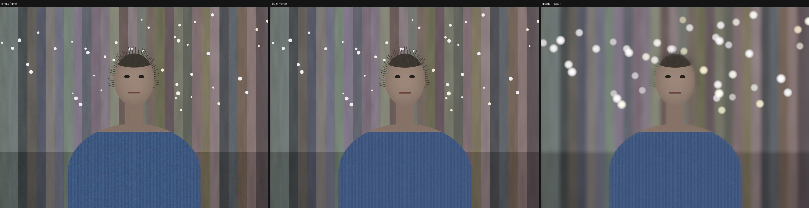
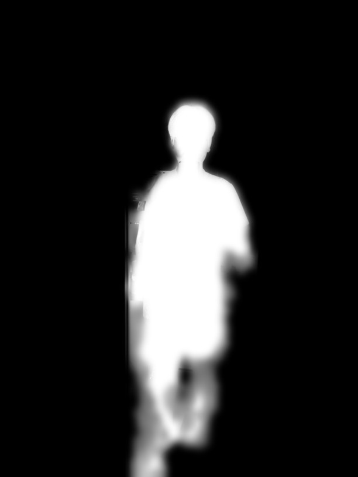
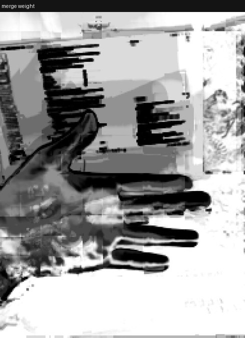
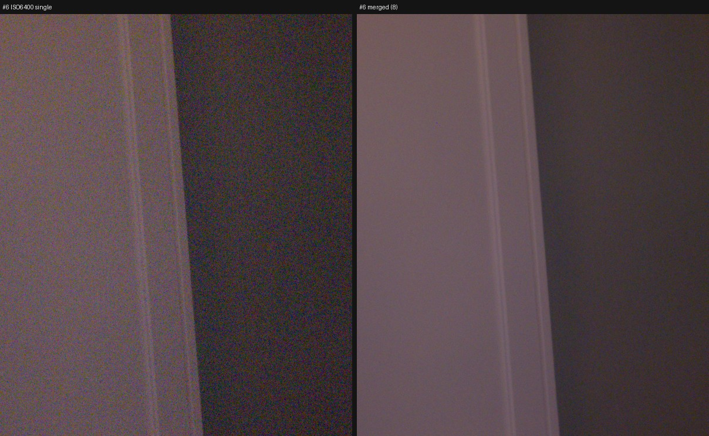
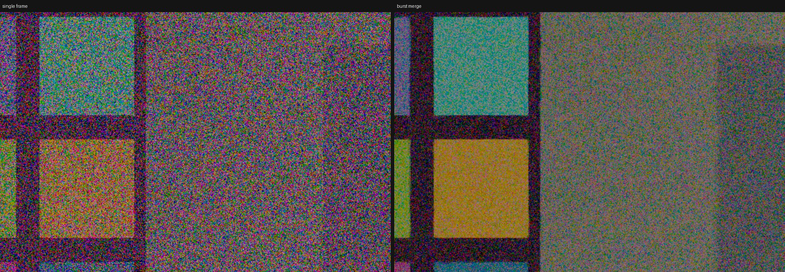
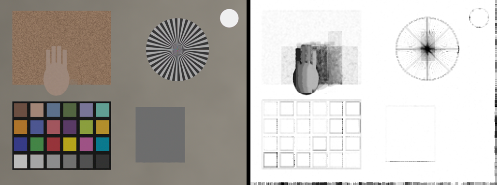

# burstpipe (rawburst-hdr)

**English** → [below](#english)

RAW 버스트 HDR(HDR+ 방식 정렬·강건 합성) + 온디바이스 세그멘테이션 인물모드 파이프라인. C++17. Android Camera2 API(Kotlin·NDK) 위에서 RAW16 버스트부터 JPEG까지 직접 처리한다.
대상 기기 Galaxy C55 (Snapdragon 7 Gen 1). **현재 단계: 에뮬레이션 완성 + Galaxy C55 실측 완료** — 아래 모든 숫자는 출처가 표시돼 있다.

> 코드 주석의 "설계문서 / 개발문서 N장" 표기는 공개하지 않은 내부 설계·구현 계획 문서를 가리킨다. 결정의 근거와 결과는 `docs/measurements.md`에 모두 옮겨 두었다.


*[PC-emu] 센서 에뮬레이터 인물 세트 4080×3060 × 8장. 단일 프레임 | 8장 합성 | 합성 + 세그 마스크 보케*

## 숫자

| 항목 | 값 | 출처 |
|---|---|---|
| SNR 이득 (8장, 평탄 영역) | **9.6 dB** (이론 √8 = 9.03) | PC-emu |
| 삼각대 합성 RMSE vs 노이즈 없는 정답 | 4.55 → **1.65 DN** (8장 평균 이론치) | PC-emu |
| 움직임 영역 가중치 / 나머지 | 0.60 / 0.92, 고스트 없음 | PC-emu |
| 세그멘테이션 대기 (임계 경로) | **0.0 ms** (지연 40 ms를 넣어도 합성 뒤에 숨음) | PC-emu |
| 스레드 스케일링 (x64) | 1→4스레드 2.9배, 1→8 5.0배 | PC-emu |
| NEON vs scalar | 전체 파이프라인 출력 bit-exact | AVD arm64 |
| Camera2 RAW 버스트 → JNI → JPEG | 동작 (드롭 0, 타임스탬프 매칭 8/8) | AVD |
| 12MP×8 합성 (NEON, big 4코어) | **295 ms** (scalar 1스레드 1425 ms) | **C55** |
| 앱 셔터→JPEG (연속 5회) | **1.04–1.14 s** | **C55** |
| SNR 이득, 실제 장면 | 정적 핸드헬드 **8.1 dB**, ISO 6400 **9.9 dB** | **C55** |
| 세그 LiteRT NPU(HTP) / GPU(OpenCL) / CPU | **9.5–24 ms** / 19–31 ms / 370 ms (CPU는 합성과 big 코어 경쟁), seg_wait 0 | **C55** |
| 보케 disc_blur / composite | 96 → **17 ms** (행 누적합) / 76 → **28 ms** | **C55** |
| 150연속 촬영 (81장~ 스로틀) | 처리 530 ms → **458 ms** (지연 거버너, N 8→6) | **C55** |
| 디모자이크 Malvar vs bilinear | +1.8 dB PSNR (에뮬 정답 대비) | PC-emu |
| Wiener 합성 (품질 모드) | 손떨림 엣지 RMSE 7.4 → **3.2 DN**, C55 0.99 s | PC-emu / C55 |
| 세그 모델 변환 (커스텀 op → TRANSPOSE_CONV) | NPU 246/246·1 파티션, 추론 4.7–5.1 ms | C55 |
| 초해상도형 합성 (실험) | 손떨림 +0.58 dB, C55 6.1 s | PC-emu / C55 |
| 앱 셔터→JPEG, 인물모드(보케 포함) | 1.24–1.32 s → **1.10–1.21 s** (NPU 세그, 누적합 보케) | **C55** |

전체 표와 해석: [docs/measurements.md](docs/measurements.md)

### 전력·에너지 (기기 전체(배터리) 기준, idle 차분 net, 30초+ 반복 구간) — [docs/power.md](docs/power.md) ([English](docs/power.en.md))

| 항목 | Galaxy C55 (SD 7 Gen 1) | Mi Mix 4 (SD 888+) |
|---|---|---|
| 세그 추론 1회 NPU / GPU / CPU | **4.4** / 8.3 / 41 mJ | INT8 **3.9**(fp16은 v68 미지원) / 7.6 / 33 mJ |
| 합성 burst 1회 (12.5MP×8) 최소 배치 | 빅 4코어 **1.67 J** (318 ms) | X1 단독 **1.52 J** (795 ms) |
| 같은 합성, 리틀 4코어 | 2.19 J (+31%) | 1.68 J (+10%) |
| 인물모드 1장 처리(합성+세그+보케) | 1.53 J, 프리뷰 유지는 2.76 W | 1.51 J, 프리뷰 유지는 3.14 W |

측정 도구: 앱 `PowerService`(BatteryManager) / shell `ShellSampler`(app_process, MIUI AutoPowerKill 회피) + cli·앱 구간 기록 → `tools/power_analyze.py`.


*[C55] 인물 세그 마스크 (NPU/GPU 추론 → 가이디드 필터 정제). 센서 방향 보정 후 전신이 잡힌다*


*[C55] 손 흔드는 장면의 합성 가중치 (검정 = 거부): 손 궤적이 0이라 다중 손 고스트가 없다*


*[C55] ISO 6400 1/30s 크롭: 단일 | 8장 합성*


*[PC-emu] 저조도(ISO 3200) 크롭: 단일 | 8장 합성*


*[PC-emu] 움직임 세트: 합성 결과(손에 고스트 없음) | 합성 가중치 맵(검정 = 거부). 스타/차트 엣지의 회색은 정수 정렬의 서브픽셀 잔차*

## 구조

```
Kotlin 앱 (Activity 1개, Camera2 RAW 버스트, 덤프/처리/EMU 버튼)
   │ JNI: direct ByteBuffer RAW16 × N + meta 문자열 → 복사 없이 Image<uint16_t>
core/ (순수 C++17, Android 의존 없음 — PC·arm64 동일 코드)
   Pipeline::run
     ├─ [세그 스레드] RAW→256² RGB → Segmenter(LiteRT CPU/GPU | emu) ──────────────┐
     ├─ gray 피라미드 → 참조 선택 → 타일 정렬(coarse-to-fine, SAD, NEON)            │
     ├─ 강건 합성 (겹침 raised-cosine 타일, 노이즈 모델 가중치, 후보 모션 재평가, NEON) │
     ├─ 마무리 (블랙/WB/클립 → bilinear 디모자이크 → CCM → Reinhard → sRGB)         │
     └─ 보케: 마스크 ← 합류(seg_wait) → 가이디드 필터 → 하이라이트 부스트 → (1−α) 정규화 디스크 블러 → 합성
emu/ (core가 모르는 에뮬레이션 계층)
   SensorEmu: 장면 → CCM⁻¹ → WB⁻¹ → EV−1.5 → Bayer → σ²=a·x+b 노이즈 → 10bit,  손떨림/움직임/저조도/인물+GT
```

설계 결정: core/는 Android를 모른다 → PC에서 알고리즘, 같은 cli를 arm64로 빌드해 `adb shell`로 측정, 앱은 마지막.
세그는 frame 0 RAW 축소본을 입력으로 받아 정렬·합성과 병렬. scalar 참조 구현은 NEON의 정답지로 남긴다.

## 무엇을 어떻게 고쳤나 (에뮬레이션 단계에서 찾은 것)

1. **합성 번짐**: 합성 타일(Bayer 32, stride 16)이 정렬 타일(gray 16) 두 개에 걸치는데 중심 타일의 err만 쓰면, 평탄한 조명 내부에서 노이즈로 정해진 엉뚱한 모션이 옆 엣지에 적용돼 조명 밝기가 벽으로 +450 DN 번졌다. 겹치는 정렬 타일 모션(최대 4개)을 후보로 합성 footprint 전체 SAD가 최소인 것을 고르고 그 SAD로 가중치 → 삼각대 RMSE 4.58 → 1.65 DN.
2. **HAL 노이즈 프로파일 신뢰성**: Android 에뮬레이터 HAL이 `noise_profile a=1.0`을 준다 → 모든 타일이 "노이즈 이내"라 고스트 거부가 꺼짐(mean_weight 0.999). 범위 검사 후 정렬 오차 중앙값 추정으로 대체 → 0.815.
3. **하이라이트 분홍**: G가 포화한 광원에서 R/B만 WB 게인만큼 커져 마젠타 → WB 후 1.0 클립.
4. **스레드풀 레이스**: 늦게 깬 워커가 다음 `parallel_for`의 인덱스를 이전 fn으로 소비할 수 있었다 → 매 generation 전 워커 체크인 (20000회 스트레스 테스트).
5. **(C55) MediaPipe 커스텀 op**: `Convolution2DTransposeBias`를 C API로 직접 구현·등록 (GPU 내장 구현과 마스크 IoU 0.998).
6. **(C55) 센서 방향**: 모델이 옆으로 누운 사람을 받아 상체만 검출 → 정립 회전 후 마스크 역회전, 전경 2.9% → 15.2%.
7. **(C55) GPU 델리게이트 스레드 친화성**: 앱에서만 추론 실패(보케가 조용히 꺼짐) → 델리게이트 전용 소유 스레드.
8. **(C55) 결과 CCM 단위행렬** → ForwardMatrix로 CCM 계산. **앱 OpenCL 폴백** → `uses-native-library`.
9. **(C55) 보케는 알고리즘이 먼저**: 원형 커널 직접 합산(O(r²)) → 행 누적합(O(r))으로 96 → 17 ms. Vulkan compute(커널 70 ms + 전송 11 ms)의 이점이 사라져 GPU 경로는 기본에서 뺐다.
10. **(C55) 측정으로 기각한 최적화**: 합성 밴드 스트리밍(대역폭 절감)이 165 → 251 ms로 역효과 — SAD가 하던 암묵적 프리페치를 깸(IPC 2.59 → 1.96). 서브픽셀 정렬은 에뮬 정답 대비 엣지 RMSE 7.4 → 8.5로 악화 → 둘 다 되돌림.
11. **(C55) 발열**: ADPF 힌트·헤드룸 API 모두 이 기기에서 미지원, Thermal Status는 스로틀 중에도 0 → 처리 시간 피드백 거버너로 N 조절.
12. **(C55) 커스텀 op 모델 수술**: MediaPipe `Convolution2DTransposeBias` → 표준 `TRANSPOSE_CONV`로 바꿔 NPU 파티션 3 → 1 (마스크 동일).
13. **(PC-emu/C55) Wiener 합성**: 서브픽셀 잔차 블러를 주파수별 수축으로 해결 (엣지 RMSE 7.4 → 3.2). `std::complex`가 `__mulsc3` 호출로 바뀌는 것을 찾아 5.4 → 0.99 s.
14. 개발문서의 정렬 테스트 텍스처 `((x/8)*73+(y/8)*151)%11`은 (32,16)px 주기 격자라 거친 단에서 가짜 정합 → 비주기 랜덤 블록으로 교체.

## 빌드·실행

```bash
# PC (Windows면 WSL2 Ubuntu)
bash scripts/test_pc.sh               # 빌드 + 테스트 10개
bash scripts/emu_bursts.sh full       # 에뮬 버스트 5세트 → bursts/emu_*
bash scripts/run_emu_demo.sh          # 결과 이미지·SNR·IoU → out/
bash scripts/bench_pc.sh              # 스레드 스윕 표

# arm64 / Android 에뮬레이터
NDK=... bash scripts/build_arm64.sh                  # ABI=x86_64, NO_NEON=1 옵션
bash scripts/fetch_litert.sh                         # (선택) LiteRT + selfie 모델 다운로드 → 실제 세그
QAIRT_SDK=... bash scripts/fetch_qnn.sh              # (선택) NPU: 로컬 QAIRT SDK에서 QNN 델리게이트·HTP v68+v69 복사
NDK=... bash scripts/build_shaders.sh                # Vulkan 셰이더 → SPIR-V 헤더 (생성물 커밋됨)
ADB=... bash scripts/bench_device.sh bursts/emu_portrait_half --threads 4 --seg-model emu_portrait_half/mask_emu.bin --delegate emu
cd android && ./gradlew assembleDebug && cd ..
ADB=... bash scripts/app_emu_test.sh                 # 앱 설치 → EMU/DUMP/SHOOT 자동 실행 → out/device_dump
```

cli: `burstpipe_cli --in DIR --out out.ppm [--frames N --threads T --cpus 4,5,6,7 --mask m.bin | --seg-model M --delegate cpu|gpu|npu|emu] [--merge spatial|wiener|superres --wiener-c 16] [--ltm] [--demosaic malvar|bilinear] [--gpu-blur] [--adpf MS --thermal-policy --csv f] [--json t.json --dump-merged --dump-weights --dump-alpha]`

앱 자동화: `adb shell am start -n dev.burstpipe/.MainActivity --es action shoot|dump|emu|stress [--ei count 30 --es policy thermal] [--es delegate npu|gpu|cpu]`

덤프 형식 (`bursts/<name>/`): `frame_NN.raw16`(W×H uint16 LE) + `meta.txt` (width/height/cfa/white_level/black_level/wb_gains/ccm/noise_profile/frame 줄). 에뮬 세트는 추가로 `truth.txt`, `mask_emu.bin`, `alpha_gt_q.pgm`, `clean_NN.raw16`.

## 저장소

```
core/include/burstpipe/  image burst timings thread_pool align merge finish bokeh seg pipeline (.h)
core/src/                구현 + *_neon.cc + seg_litert.cc(LiteRT/QNN) + gpu_blur.cc(Vulkan) + perf_hint.cc(ADPF/발열) + shaders/
core/tests/              stage당 1개 + test_threadpool + test_seg(방향·거버너) + test_demosaic/test_superres(정답 PSNR) + test_pipeline(에뮬 수용)
core/cli/                burstpipe_cli
emu/                     센서 에뮬레이터 (burstpipe_emu)
android/                 Gradle 앱 (Kotlin Camera2 + jni.cc + ndk_camera.cc)
tools/                   view_raw snr snr_auto rmse_clean seg_infer convert_selfie_model mask_iou compare3 plot_timings ppm2png (.py)
                         power_analyze power_report power_e3 power_gaps quantize_selfie_int8 (.py, 전력·INT8)
scripts/                 build_pc test_pc emu_bursts run_emu_demo bench_pc build_arm64 build_shaders bench_device trace_device perf_device app_emu_test fetch_litert fetch_qnn
                         power_cli power_app (전력 실험 러너)
docs/                    measurements.md, hardware_test.md, power.md(전력), power_issues.md(이슈 기록), img/
results/power/           전력 분석 결과 JSON (원본 샘플은 저장소 밖)
```

## 옵션 모드 (모두 구현·측정됨)
`--merge wiener` (HDR+ 주파수 합성) · `--merge superres` (Wronski형, 실험) · `--ltm` (Mertens 로컬 톤매핑) · `--demosaic bilinear` · `--gpu-blur` (Vulkan) · 앱 `--es capture ndk` (Camera2 NDK) · `--es delegate npu|gpu|cpu`

## 하지 않은 것
- fp16 merge (정밀도: measurements.md 7장), 초해상도의 실시간화 (6.1 s)

## 참고
Hasinoff et al. 2016 *Burst photography for high dynamic range and low-light imaging on mobile cameras* (HDR+) ·
He et al. 2010 *Guided Image Filtering* · MediaPipe Selfie Segmentation

---

## English

**burstpipe** is a RAW burst HDR pipeline (HDR+-style tile alignment and robust merge) with an on-device segmentation portrait mode, written in C++17.
It processes RAW16 bursts all the way to JPEG on top of the Android Camera2 API (Kotlin + NDK).
Target devices: Galaxy C55 (Snapdragon 7 Gen 1) and, for the power and porting work, Xiaomi Mi Mix 4 (Snapdragon 888+). Every number below says where it was measured.

> Comments in the code that say "설계문서 / 개발문서 chapter N" refer to internal design and implementation notes that are not published. The reasoning and results from them are in `docs/measurements.md`.

Labels: **PC-emu** = x64 PC with the sensor emulator (algorithm quality, not device speed) · **AVD** = Android emulator (flow only, timings meaningless) · **C55** / **Mix4** = measured on the phone.

### Numbers

| Item | Value | Source |
|---|---|---|
| SNR gain (8 frames, flat region) | **9.6 dB** (theory √8 = 9.03) | PC-emu |
| Tripod merge RMSE vs noise-free ground truth | 4.55 → **1.65 DN** (8-frame average theory) | PC-emu |
| Merge weight in moving region / elsewhere | 0.60 / 0.92, no ghosting | PC-emu |
| Segmentation wait on the critical path | **0.0 ms** (hidden behind the merge even with 40 ms injected latency) | PC-emu |
| Thread scaling (x64) | 1→4 threads 2.9×, 1→8 5.0× | PC-emu |
| NEON vs scalar | whole-pipeline output bit-exact | AVD arm64 |
| Camera2 RAW burst → JNI → JPEG | works (0 drops, timestamps matched 8/8) | AVD |
| 12 MP × 8 merge (NEON, 4 big cores) | **295 ms** (scalar 1 thread 1425 ms) | **C55** |
| App shutter → JPEG (5 in a row) | **1.04–1.14 s** | **C55** |
| SNR gain on real scenes | static handheld **8.1 dB**, ISO 6400 **9.9 dB** | **C55** |
| Segmentation LiteRT NPU (HTP) / GPU (OpenCL) / CPU | **9.5–24 ms** / 19–31 ms / 370 ms (CPU competes with the merge for big cores), seg_wait 0 | **C55** |
| Bokeh disc_blur / composite | 96 → **17 ms** (row prefix sums) / 76 → **28 ms** | **C55** |
| 150 consecutive shots (throttling from shot ~81) | processing 530 → **458 ms** (latency governor, N 8→6) | **C55** |
| Malvar vs bilinear demosaic | +1.8 dB PSNR (vs emulator ground truth) | PC-emu |
| Wiener merge (quality mode) | handshake edge RMSE 7.4 → **3.2 DN**, 0.99 s on C55 | PC-emu / C55 |
| Segmentation model surgery (custom op → TRANSPOSE_CONV) | NPU 246/246 nodes, 1 partition, 4.7–5.1 ms | C55 |
| Super-resolution-style merge (experimental) | handshake +0.58 dB, 6.1 s on C55 | PC-emu / C55 |
| App shutter → JPEG, portrait mode (with bokeh) | 1.24–1.32 s → **1.10–1.21 s** (NPU segmentation, prefix-sum bokeh) | **C55** |

Full tables and discussion (Korean): [docs/measurements.md](docs/measurements.md)

### Power and energy — [docs/power.en.md](docs/power.en.md), issue log [docs/power_issues.en.md](docs/power_issues.en.md)

Whole-device (battery) power with the idle baseline subtracted (net), measured over windows of at least 30 s of repeated work, median of 3 runs (E3: 2).
Neither phone exposes per-rail power (no ODPM), so these numbers include DRAM, power-delivery losses and so on, not just the SoC.

| Item | Galaxy C55 (SD 7 Gen 1) | Mi Mix 4 (SD 888+) |
|---|---|---|
| Segmentation, one inference: NPU / GPU / CPU | **4.4** / 8.3 / 41 mJ | INT8 **3.9** (fp16 unsupported on HTP v68) / 7.6 / 33 mJ |
| Merge, one burst (12.5 MP × 8), lowest-energy placement | 4 big cores **1.67 J** (318 ms) | X1 alone **1.52 J** (795 ms) |
| Same merge on 4 little cores | 2.19 J (+31%) | 1.68 J (+10%) |
| One portrait shot, processing (merge + segmentation + bokeh) | 1.53 J; keeping the preview running costs 2.76 W | 1.51 J; preview 3.14 W |

Findings in short:
- **Race-to-idle depends on the SoC.** On the C55 the big cores finish fastest and use the least energy (little cores +31%). On the Mix 4 the single X1 core is cheapest and all NEON placements are within ±5%.
- **Energy per inference decides, not power.** The C55 NPU draws 4× the power of the GPU but finishes 8× sooner, so it uses half the energy.
- **The camera preview costs more than the processing** for a single shot (about 3.3 J of preview vs 1.8 J of processing on the C55).
- **On the Mix 4, an fp16 model silently runs on the CPU.** The NPU delegate reports "ok", but HTP v68 has no fp16, so all 246 ops fall back (33.6 mJ, same as CPU). An INT8 model puts all 136 nodes on the NPU (3.88 mJ), but its masks still differ from float on some scenes (portrait IoU 0.86).
- **The governor had no measurable energy effect over 150 shots** (±1%). The C55 throttles in two steps (7–9 s and 86–99 s); the Mix 4 OS caps the CPU at 1.56 GHz as soon as the camera is open.

Tools: the app's `PowerService` (BatteryManager) and a shell-uid `ShellSampler` (`app_process`, survives MIUI AutoPowerKill), plus window markers from the cli and the app, integrated by `tools/power_analyze.py`.

### Architecture

```
Kotlin app (one Activity, Camera2 RAW burst, dump/process/EMU buttons)
   │ JNI: direct ByteBuffer RAW16 × N + meta string → wrapped as Image<uint16_t> without copying
core/ (plain C++17, no Android dependency — same code on PC and arm64)
   Pipeline::run
     ├─ [seg thread] RAW → 256² RGB → Segmenter (LiteRT CPU/GPU/NPU | emu) ────────────┐
     ├─ gray pyramid → reference selection → tile alignment (coarse-to-fine, SAD, NEON) │
     ├─ robust merge (overlapping raised-cosine tiles, noise-model weights, candidate motion re-check, NEON)
     ├─ finish (black/WB/clip → demosaic → CCM → Reinhard → sRGB)                      │
     └─ bokeh: mask ← join (seg_wait) → guided filter → highlight boost → (1−α)-normalised disc blur → composite
emu/ (emulation layer that core/ knows nothing about)
   SensorEmu: scene → CCM⁻¹ → WB⁻¹ → EV−1.5 → Bayer → σ² = a·x + b noise → 10 bit; handshake / motion / low light / portrait + ground truth
```

Design: core/ does not know about Android. Algorithms are developed on the PC, the same cli is built for arm64 and measured over `adb shell`, and the app comes last.
Segmentation takes a downscaled frame 0 and runs in parallel with alignment and merge. The scalar reference implementation stays as the ground truth for NEON.

### What was found and fixed

1. **Merge bleeding**: a merge tile spans two alignment tiles; using only the centre tile motion applied noise-driven motion to neighbouring edges and bled a lamp +450 DN into the wall. Picking, among up to 4 overlapping motions, the one with the lowest SAD over the whole footprint → tripod RMSE 4.58 → 1.65 DN.
2. **Untrustworthy HAL noise profile**: the emulator HAL reports `noise_profile a=1.0`, which disabled ghost rejection (mean weight 0.999). Range check + estimate from alignment error → 0.815.
3. **Pink highlights**: R/B scaled by WB gains where G was clipped → clip to 1.0 after WB.
4. **Thread-pool race**: a late worker could consume the next `parallel_for` index with the previous function → per-generation check-in (20 000-iteration stress test).
5. **(C55) MediaPipe custom op** `Convolution2DTransposeBias` implemented and registered through the C API (mask IoU 0.998 vs the GPU built-in).
6. **(C55) Sensor orientation**: the model saw a person lying sideways and found only the upper body → rotate upright and rotate the mask back; foreground 2.9% → 15.2%.
7. **(C55) GPU delegate thread affinity**: inference failed only in the app (bokeh silently off) → one owner thread for the delegate.
8. **(C55) Identity CCM in capture results** → CCM from ForwardMatrix. **OpenCL fallback in the app** → `uses-native-library`.
9. **(C55) Algorithm before GPU for bokeh**: direct disc sum O(r²) → row prefix sums O(r), 96 → 17 ms. The Vulkan path (70 ms kernel + 11 ms transfer) lost its advantage and is off by default.
10. **(C55) Optimisations rejected by measurement**: the band-streaming merge got slower (165 → 251 ms; IPC 2.59 → 1.96, it broke the implicit prefetch the SAD pass was doing). Sub-pixel alignment made edge RMSE worse (7.4 → 8.5). Both reverted.
11. **(C55) Heat**: ADPF hints and thermal headroom are unsupported on this device, and Thermal Status stays 0 while throttling → a processing-time feedback governor adjusts N.
12. **(C55) Model surgery**: custom op → standard `TRANSPOSE_CONV`, NPU partitions 3 → 1 (same mask).
13. **(PC-emu/C55) Wiener merge**: frequency-domain shrinkage fixes sub-pixel edge blur (edge RMSE 7.4 → 3.2). `std::complex` multiplication was compiling to `__mulsc3` calls; removing that took it from 5.4 to 0.99 s.
14. The alignment test texture from the design notes was periodic and caused false matches at coarse levels → replaced with non-periodic random blocks.
15. **(Mix 4 port)** fp16 model silently on CPU (HTP v68) → INT8 model; 27 MP-only RAW caused a Java heap OOM → centre-crop to 4080×3072; MIUI AutoPowerKill and background limits killed the sampler → shell-uid sampler with its own wake lock. Details in [docs/power_issues.en.md](docs/power_issues.en.md).

### Build and run

```bash
# PC (WSL2 Ubuntu on Windows)
bash scripts/test_pc.sh               # build + 10 tests
bash scripts/emu_bursts.sh full       # 5 emulated bursts → bursts/emu_*
bash scripts/run_emu_demo.sh          # result images, SNR, IoU → out/
bash scripts/bench_pc.sh              # thread sweep table

# arm64 / Android
NDK=... bash scripts/build_arm64.sh                  # options: ABI=x86_64, NO_NEON=1
bash scripts/fetch_litert.sh                         # (optional) LiteRT + selfie model → real segmentation
QAIRT_SDK=... bash scripts/fetch_qnn.sh              # (optional) NPU: QNN delegate + HTP v68/v69 libraries from a local QAIRT SDK
NDK=... bash scripts/build_shaders.sh                # Vulkan shaders → SPIR-V headers (generated files are committed)
ADB=... bash scripts/bench_device.sh bursts/emu_portrait_half --threads 4 --seg-model emu_portrait_half/mask_emu.bin --delegate emu
cd android && ./gradlew assembleDebug && cd ..
ADB=... bash scripts/app_emu_test.sh                 # install app → run EMU/DUMP/SHOOT → out/device_dump

# power measurement (cable unplugged, wireless adb)
ADB="adb -s <ip>:5555" bash scripts/power_cli.sh c55 E1 3                  # segmentation backends
ADB="adb -s <ip>:5555" SAMPLER=shell bash scripts/power_cli.sh mix4 E2 3   # merge core placement (MIUI: shell sampler)
ADB="adb -s <ip>:5555" DELEGATE=npu bash scripts/power_app.sh c55 E4 3     # per-stage app energy
python tools/power_report.py c55 mix4                                      # tables
```

cli: `burstpipe_cli --in DIR --out out.ppm [--frames N --threads T --cpus 4,5,6,7 --mask m.bin | --seg-model M --delegate cpu|gpu|npu|emu] [--merge spatial|wiener|superres --wiener-c 16] [--ltm] [--demosaic malvar|bilinear] [--gpu-blur] [--adpf MS --thermal-policy --csv f] [--json t.json --dump-merged --dump-weights --dump-alpha] [--seconds S --seg-only --idle S --power-json w.json --label L]`

App automation: `adb shell am start -n dev.burstpipe/.MainActivity --es action shoot|dump|emu|stress|pstage [--ei count 150 --es policy off|thermal] [--es stage idle|capture|plain|portrait|seg|jpeg --ei seconds 30 --es label L] [--es delegate npu|gpu|cpu]`

Dump format (`bursts/<name>/`): `frame_NN.raw16` (W×H uint16 LE) + `meta.txt` (width/height/cfa/white_level/black_level/wb_gains/ccm/noise_profile/frame lines). Emulated sets also have `truth.txt`, `mask_emu.bin`, `alpha_gt_q.pgm`, `clean_NN.raw16`.

### Repository

```
core/include/burstpipe/  image burst timings thread_pool align merge finish bokeh seg pipeline power (.h)
core/src/                implementation + *_neon.cc + seg_litert.cc (LiteRT/QNN) + gpu_blur.cc (Vulkan) + perf_hint.cc (ADPF/thermal) + power.cc + shaders/
core/tests/              one per stage + thread pool + seg (orientation, governor) + demosaic/superres (PSNR vs truth) + pipeline (emulator acceptance)
core/cli/                burstpipe_cli
emu/                     sensor emulator (burstpipe_emu)
android/                 Gradle app (Kotlin Camera2 + jni.cc + ndk_camera.cc + PowerService/ShellSampler)
tools/                   analysis scripts, incl. power_analyze, power_report, power_e3, quantize_selfie_int8 (.py)
scripts/                 build / test / device benchmark / power_cli, power_app runners
docs/                    measurements.md, power.md / power.en.md, power_issues.md / power_issues.en.md, hardware_test.md, img/
results/power/           power analysis JSONs (raw 50 ms samples are kept outside the repo)
```

### Optional modes (all implemented and measured)
`--merge wiener` (HDR+ frequency-domain merge) · `--merge superres` (Wronski-style, experimental) · `--ltm` (Mertens local tone mapping) · `--demosaic bilinear` · `--gpu-blur` (Vulkan) · app `--es capture ndk` (Camera2 NDK) · `--es delegate npu|gpu|cpu`

### Not done
- fp16 merge (precision: measurements.md ch. 7), real-time super-resolution (6.1 s)
- Moving the app to LiteRT 1.4.2 so it can use the INT8 model on the Mix 4 NPU, and fixing INT8 mask accuracy

### References
Hasinoff et al. 2016 *Burst photography for high dynamic range and low-light imaging on mobile cameras* (HDR+) ·
He et al. 2010 *Guided Image Filtering* · MediaPipe Selfie Segmentation
